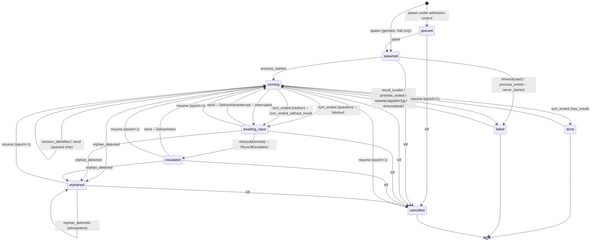

# Worker state machine

> **Merge gate.** This file is the single source of truth for the worker
> lifecycle and it mirrors `src/fsm.rs` **1:1**. Any PR that changes `step()`
> updates this table *and* `tests/fsm_table.rs` in the same commit. The match in
> `step()` has **no catch-all arm** over `(state, event)` pairs — a source-scan
> test (`totality_no_catch_all_arm_in_source`) enforces it, so a totality break
> is a build/test failure, not a silent default. Totality break = no merge.

Spec: §4.6. Corpus: `appendix-fsm.md` C1 (totality, determinism, explicit
rejections), C2 (time as events, terminal states), C6/C8 (checked-in table as
merge gate).

`step()` is **pure**: no IO, no clock, no randomness.

```rust
pub fn step(current: WorkerState, reason: Option<StateReason>, ev: &FsmEvent)
    -> Result<Transition, Rejected>;
```

Time enters only as `Timeout { kind }` — deadlines are persisted absolute
instants (`deadline_at` in `state.json`), re-armed on restart and fired
immediately if already past. Every accepted transition returns
`Transition { state, reason, failure, epoch_bump, actions }`; the caller
performs `actions` **after** the event is durably appended to the WAL
(append + fsync → side effect → atomic snapshot rewrite).

## States

| State | Terminal? | Meaning |
|---|---|---|
| `spawned` | no | Worker directory + brief exist; the process is not up yet. Guarded by the **start deadline**. |
| `queued` | no | Awaiting an admission slot (Phase 2 broker). Phase 1 never enters this state. |
| `running` | no | A codex turn is live for the current epoch. |
| `awaiting-input` | no | Turn boundary reached; the human owns the next move. Reason: `blocked`, `interrupted`, or `turn_ended_without_result`. |
| `escalated` | no | Blocked past `blocked_timeout`; concurrency slot freed, worktree kept, resumable. Reason: `blocked_timeout`. |
| `orphaned` | no | Process is gone and no result was produced; **gc-exempt**, resumable. |
| `done` | **yes** | Turn ended with a result. |
| `failed` | **yes** | Carries a `FailureClass` (see below). |
| `cancelled` | **yes** | A human stopped it. **Never** carries a failure class — retry policy must never auto-retry a human stop. |
| `unknown` | no | Open-enum landing pad: a `state.json` written by a newer `a2a`. Every event is rejected. |

`FailureClass`: `rate_limit`, `auth_expired`, `network`, `model_error`,
`timeout`, `sandbox_denied`, `schema_violation`, `no_result`,
`budget_exhausted`, `never_started`, `internal_panic`, `session_missing`,
`unknown`.

`Action`: `DeliverInbox`, `KillProcess`, `RecordEscalation`.

## Transition table (accepted rows)

Every `Ok` arm in `step()` appears here; anything **not** listed for a state is
an explicit `Rejected` with an actionable reason (see [Rejections](#rejections)).

| From | Event | Guard | To | Actions | Notes |
|---|---|---|---|---|---|
| *(genesis)* | `spawn` | applied by `fold()` only | `spawned` | — | `step()` rejects `spawn` from **every** state; it is the fold's genesis special-case (see `src/fold.rs`). |
| `queued` | `admit` | — | `spawned` | — | Phase 2 admission control. |
| `queued` | `kill` | — | `cancelled` | — | No process to signal yet. |
| `spawned` | `process_started` | — | `running` | — | Caller records `pid` + `start_witness`. |
| `spawned` | `process_exited` | — | `failed{never_started}` | — | A worker whose process never came up stays distinguishable from one that ran and died. |
| `spawned` | `timeout` | `kind = start` | `failed{never_started}` | — | The start deadline; an exec/fork failure must not look healthy. |
| `spawned` | `kill` | — | `cancelled` | — | Never `failed`. |
| `running` | `session_identified` | — | `running` *(reason preserved)* | — | Self-loop; records `session_id` / `rollout_path` for resume. |
| `running` | `send` | — | `running` *(reason preserved)* | **none** | On the exec transport the message only **queues**; delivery happens at the next turn boundary. The FSM emits no action; the app-server transport additionally steers the live turn broker-side (§4.3). |
| `running` | `turn_ended` | `has_result` | `done` | — | Result wins over a question in the same turn. |
| `running` | `turn_ended` | `!has_result && has_question` | `awaiting-input{blocked}` | — | The `outbox/<seq>.question.json` file, not the prose, drives this. |
| `running` | `turn_ended` | `!has_result && !has_question` | `awaiting-input{turn_ended_without_result}` | — | Turn ended with nothing to show. |
| `running` | `result_invalid` | — | `failed{schema_violation}` | — | Result present but does not match the brief's required format. |
| `running` | `process_exited` | — | `failed{no_result}` | — | Ran and died mid-turn. |
| `running` | `session_missing` | — | `failed{session_missing}` | — | Reconcile: a resumed process died before its first turn. Distinct from `no_result`. |
| `running` | `timeout` | `kind = task` | `failed{timeout}` | `KillProcess` | The task deadline. |
| `running` | `interrupt` | — | `awaiting-input{interrupted}` | — | Steering pause at the turn boundary. |
| `running` | `kill` | — | `cancelled` | `KillProcess` | **Cancelled, never failed.** |
| `running` | `orphan_detected` | — | `orphaned` | — | `run.lock` free, no result: reconcile's liveness verdict. |
| `awaiting-input` | `send` | — | `running` | `DeliverInbox` | The answer is delivered via a 0600 prompt file on the resumed process's stdin. |
| `awaiting-input` | `timeout` | `kind = blocked` | `escalated{blocked_timeout}` | `RecordEscalation` | Frees the concurrency slot, keeps the worktree, fires `on_escalate`. |
| `awaiting-input` | `kill` | — | `cancelled` | — | Never `failed`. |
| `awaiting-input` | `orphan_detected` | — | `orphaned` | — | |
| `awaiting-input` | `resume` | — | `running` **(epoch+1)** | — | `answer_queued` is informational for the `resume` command; the FSM emits no action. |
| `escalated` | `send` | — | `running` | `DeliverInbox` | Answering an escalation resumes it directly. |
| `escalated` | `kill` | — | `cancelled` | — | |
| `escalated` | `resume` | — | `running` **(epoch+1)** | — | |
| `escalated` | `orphan_detected` | — | `orphaned` | — | |
| `orphaned` | `resume` | — | `running` **(epoch+1)** | — | Orphans are resumable; that is why the state is non-terminal. |
| `orphaned` | `kill` | — | `cancelled` | — | **Cancelled, never failed.** |
| `orphaned` | `orphan_detected` | — | `orphaned` *(reason preserved)* | — | Idempotent: re-detection is a no-op. |
| `done` \| `failed` \| `cancelled` | `resume` | — | `running` **(epoch+1)** | — | The **only** door out of a terminal state. |

**Epoch fencing.** `epoch_bump` is set exactly on the `resume` rows. Every
event carries its epoch; the fold discards stale-epoch events so a flushed
buffer from a dead prior run cannot resurrect a resumed worker.

## Rejections

`Rejected { from, event, reason }` is surfaced verbatim by the CLI, and every
reason names the command that *would* work.

**Universal:** `spawn` is legal from **no** state —
`genesis only — `spawn` creates a worker; it is never applied to an existing one`.

| From | Rejected events | Reason |
|---|---|---|
| `queued` | `process_started`, `session_identified`, `turn_ended`, `result_invalid`, `process_exited`, `session_missing`, `timeout`, `interrupt`, `orphan_detected`, `resume`, `send` | worker is queued and has no process yet — only admission or `a2a kill` apply |
| `spawned` | `timeout{task\|blocked}` | only the start deadline is armed before the process comes up |
| `spawned` | `admit`, `session_identified`, `turn_ended`, `result_invalid`, `session_missing`, `interrupt`, `orphan_detected`, `resume`, `send` | worker has not started its process yet — wait for it to run, or `a2a kill` it |
| `running` | `timeout{start}` | the start deadline is disarmed once the process is running |
| `running` | `timeout{blocked}` | the blocked deadline is armed only in awaiting-input |
| `running` | `admit` | worker was admitted already — it is running |
| `running` | `process_started` | worker already has a live process for this epoch |
| `running` | `resume` | worker is already running — nothing to resume |
| `awaiting-input` | `timeout{start\|task}` | only the blocked deadline is armed while awaiting input |
| `awaiting-input` | `admit`, `process_started`, `session_identified`, `turn_ended`, `result_invalid`, `process_exited`, `session_missing`, `interrupt` | worker is waiting for an answer — use `a2a send`, or `a2a resume`/`a2a kill` |
| `escalated` | `admit`, `process_started`, `session_identified`, `turn_ended`, `result_invalid`, `process_exited`, `session_missing`, `timeout`, `interrupt` | worker escalated to a human — answer with `a2a send`, or `a2a resume`/`a2a kill` |
| `orphaned` | `admit`, `process_started`, `session_identified`, `turn_ended`, `result_invalid`, `process_exited`, `session_missing`, `timeout`, `interrupt`, `send` | worker is orphaned (its process is gone) — use `a2a resume` or `a2a kill` |
| `done` \| `failed` \| `cancelled` | everything except `resume` (`admit`, `process_started`, `session_identified`, `turn_ended`, `result_invalid`, `process_exited`, `session_missing`, `timeout`, `interrupt`, `kill`, `orphan_detected`, `send`) | worker is `<state>` — use `a2a resume` to continue it |
| `unknown` | **all** events | unrecognized worker state — this worker was written by a newer a2a; upgrade the CLI |

Terminal states are **absorbing**: `send` to a terminal worker is rejected with
a pointer to `resume` (never an implicit resume — that would silently spend
quota), and `kill`/`interrupt` on a finished worker is a rejected no-op rather
than a state change.

## Diagram



*(Mermaid ids cannot contain a hyphen; `awaiting_input` above is the
`awaiting-input` state.)*

## Invariants pinned by `tests/fsm_table.rs`

1. **Totality (source scan)** — `step()` contains no `_ =>` or `(_, _)` arm.
2. **Decidability** — every `(state, event)` pair returns `Ok` or `Rejected`; never panics.
3. **Terminal absorption** — `done`/`failed`/`cancelled` reject everything but `resume`, which returns `running` with `epoch_bump`.
4. **Start lifecycle** — `spawned + process_started → running`; `spawned + timeout{start}` and `spawned + process_exited` → `failed{never_started}`.
5. **Kill is cancelled, never failed** — from `running`, `awaiting-input`, and `orphaned`; `failure` is always `None`.
6. **Send semantics** — `running + send` yields no actions (queue only); `awaiting-input + send` yields `DeliverInbox`.
7. **Escalation & session loss** — `awaiting-input + timeout{blocked} → escalated`; `running + session_missing → failed{session_missing}` (distinct from `no_result`).
8. **Reachability** — BFS from *every* state reaches a terminal state.
