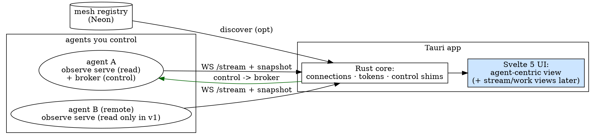

# a2a Management App (Tauri) — Design

**Status:** approved-shape, open questions resolved 2026-09-21 (see
**Resolved decisions**). Spec for review.
**Sub-project:** 2 of 2. Consumes the **Observability Plane** contract
(`2026-09-17-a2a-observability-plane-design.md`). Read that first — this spec
does not redefine the Event envelope or endpoints.

## Goal

A desktop app that gives a human full visibility into every agent they control
— the mesh traffic and each agent's Codex workers — and lets them act: steer a
worker, spawn/kill, approve work, and (subject to the capability prerequisites
below) manage the agent itself.

## Stack & repo

- **Tauri + Svelte 5 + Vite**, matching keydrill. Its own repo (e.g.
  `Dev916/a2a-console`), beads-tracked with its own prefix.
- Rust (Tauri) side is thin: connection management, the read-token/registry
  credentials, and the control shims (shell to `a2a` / local broker). All
  view/state logic is Svelte.

## Scope

**v1 builds:**
- **Agent-centric** primary view (fleet → agent → its workers / mesh / work).
- **Both** discovery modes: a manual endpoint list *and* registry-assisted
  auto-discovery.
- Live view via the plane's `WS /stream` + `GET /snapshot`; read-only reads.
- The v1 control set (below), for agents whose broker is locally reachable.

**Deferred (tracked):**
- Activity-stream view — bead **a2a-zzj**.
- Work-centric view — bead **a2a-67t**.
  (Both are pure front-end views over the same plane Events; migrate these
  beads into the app repo when it's scaffolded.)

**Out of scope:** the plane itself (Epic 1); the central collector; mobile.

## Architecture & data flow

- **Read** is uniform and federated: the app holds N connections, one per
  agent's `observe serve` endpoint, consuming `WS /stream` (+ an initial
  `/snapshot`). Cross-agent state is merged in the app from the shared Event
  contract. Remote agents are first-class for *reading*.
- **Control** is separate and goes to the agent's **broker**, never the plane
  (the plane is read-only by invariant). See the next section — this is where
  reach and capability limits live.
- **Discovery:** manual entries (`host:port` + read token, optional broker
  reach info) *and* an optional pass that reads the registry to list enrolled
  agents and their endpoints. Manual always wins on conflict.

## Control: reach and capability (the load-bearing section)

Two independent axes gate every control: **can the app reach the agent's
broker**, and **does a2a expose the action at all**.

### Reach
- **Locally-reachable agent** (its broker is on the same machine as the app, or
  the operator supplies a broker transport): the app shells to the `a2a` CLI /
  local broker. Full control in v1.
- **Remote agent** (broker on another machine): a2a has **no operator control
  transport** today — the plane is read-only and the mesh is agent-to-agent,
  not operator-to-agent. So in v1, remote agents are **read + monitor only**;
  their control buttons render disabled with "needs the control channel." A
  network control path is the deferred **control spike** (plane option 2). This
  is a deliberate v1 boundary, not an oversight.

### Capability — the requested v1 controls, mapped

| Control | Target | Maps to | v1 status |
|---|---|---|---|
| Steer / answer | worker | `a2a send <w> --kind answer\|message` | ✅ exists |
| Interrupt / kill | worker | `a2a interrupt` / `a2a kill` | ✅ exists |
| Spawn worker | agent | `a2a spawn --lane --brief` | ✅ exists |
| Approve / release work | agent | `mesh work approve` / `release` | ✅ exists |
| Change model & effort — **worker** | worker | respawn with new params | 🟡 needs a broker lever (respawn `--model/--effort` if not already there) |
| Change model & effort — **agent** | orchestrator | Claude Code runtime setting | 🔴 gap — a2a has no lever on a running Claude session |
| Run compact — **worker** | worker (codex) | codex context mgmt | 🔴 gap — no exposed compact for workers |
| Run compact — **agent** | orchestrator | Claude `/compact` (cf. precompact-herdr injector) | 🔴 gap — needs an imperative channel to the orchestrator |
| Kick off brainstorming | orchestrator | run the brainstorming skill on a topic | 🔴 gap — needs an imperative channel to the orchestrator |

**The pattern in the 🔴 rows:** they all *command the Claude orchestrator
agent itself*, not a Codex worker. a2a today controls **workers** (the broker
surface) and gossips to agents **ambiently** (mesh notes / `mesh inject`); it
has no *imperative* "do X now" channel to the orchestrator. Delivering the full
requested control set therefore depends on a new a2a-side capability:

> **Prerequisite — Agent Command Channel (a2a-side):** an imperative,
> authenticated channel that delivers a directive to the Claude orchestrator
> (compact now / change model+effort / begin a brainstorm on topic T / …) and
> reports the outcome. This is the concrete requirement under the plane's
> deferred "control spike," and it is what unlocks the 🔴 rows and remote
> control together.
>
> **Decided 2026-09-21: build it.** The Agent Command Channel is a committed
> a2a-core capability, not an open question — it is what makes the requested
> agent-level controls and remote control real. It is architectural in its own
> right (a new authenticated imperative surface on the orchestrator), so it gets
> its **own brainstorm + spec** when we build it; this app spec only depends on
> its contract. Sequencing: it lands after the read-only plane (Epic 1), and the
> 🔴 controls + remote control ship with it (see **Phasing** step 3).

**Consequence for v1:** the app ships the ✅ controls now (worker steer/answer,
interrupt/kill, spawn, work approve/release) for locally-reachable agents. The
🟡 worker model/effort change is a small a2a broker addition we can fold in. The
🔴 orchestrator-level controls (agent model/effort, compact either side,
brainstorm-kickoff) are **gated on the Agent Command Channel** and land with it
— the app reserves the UI affordances (buttons present, disabled with a clear
"needs agent command channel") so the surface is designed in but not faked.

## The agent-centric view (v1)

- **Fleet pane:** every connected agent — identity, online/degraded, worker
  count, active-work count, health (from `health`-plane Events). Sourced from
  each agent's `/snapshot` + live `WS /stream`.
- **Agent detail:** on select, three linked panels:
  - **Workers:** live list (status, lane, worktree, turn budget, last result,
    an awaiting-input badge with the question). Row actions = the reachable
    controls.
  - **Mesh:** this agent's feed + peers + inbound/outbound work items.
  - **Activity:** this agent's Event stream (the per-agent slice of the later
    global activity-stream view).
- **Worker drill-in:** result, verification, lifecycle timeline; a link to the
  reserved depth-2 forensic (`turn`/`tool_call`) view when that plane lands.
- Live throughout via `WS /stream`; reconnect resumes from the last cursor.

## Visual design — "pane of glass"

The entire UI reads as one large pane of frosted glass: a translucent,
backdrop-blurred surface with soft edge/inner highlights, thin light borders,
and layered panes that float with depth via translucency + soft shadow rather
than hard opaque cards. Controls (buttons, toggles, inputs, row actions) are
glass to match — but tuned so everything stays **clearly readable at a glance**
("see it clearly"): glassmorphism is the skin, never at the cost of clarity.

Principles:
- **One cohesive glass system** — consistent blur radius, translucency, border,
  and highlight design tokens across every pane and every control, so the whole
  frame reads as a single sheet of glass.
- **Legibility first** — text and icons sit on a sufficiently opaque layer (or
  carry a subtle scrim); text and interactive-state contrast must meet WCAG AA
  *through* the glass. This is a hard requirement, not a nicety.
- **Status stays unmistakable** — live/critical states (awaiting-input,
  degraded, killed, work-failed) read instantly even against a translucent
  surface (accent tint + solid indicator, not blur-dependent).
- **Depth, not chrome** — layering and soft shadow over heavy borders; a calm
  background (subtle gradient / desktop tint) gives the glass something to
  refract.
- **Theme-aware** — the glass system defines both light and dark palettes.
- Refined at build time with the **frontend-design** skill; this section fixes
  the aesthetic *direction*, not the exact tokens.

## Security & credentials

- The app stores per-agent **read tokens** (plane) and, for controllable
  agents, whatever the local broker needs — in the OS keychain via Tauri, never
  plaintext on disk.
- Registry-assisted discovery uses a read-scoped registry credential the
  operator supplies; it lists agents/endpoints but grants no control.
- Control actions are confirmed in-app before firing (kill/compact/model-change
  are irreversible-ish), matching a2a's "confirm side-effectful actions" stance.
- The app never sees worker/agent secrets — it reads normalized Events and
  issues named control verbs.

## Testing strategy

- **Rust core:** connection lifecycle, token storage, control-shim command
  construction (unit), reconnect-with-cursor.
- **UI:** component tests over fixture Event streams (agent-centric render,
  awaiting-input badge, control enable/disable by reach+capability).
- **Integration (devloop-style):** run `a2a observe serve` over a seeded home,
  point the app at it, assert the fleet/worker/mesh panels render live and a
  ✅ control (e.g. send/answer) round-trips to the local broker.
- **Reach/capability matrix:** assert 🔴/remote controls render disabled with
  the right reason, and ✅ controls enabled, given a snapshot's reach flags.

## Phasing

1. **v1:** agent-centric view + both-discovery + live read + the ✅ control set
   for locally-reachable agents; 🔴 affordances present-but-disabled.
2. **Deferred views:** activity-stream (a2a-zzj), work-centric (a2a-67t).
3. **With the Agent Command Channel + control spike:** enable the 🔴 controls
   and remote control.
4. **With depth-2 plane:** the per-worker forensic (`turn`/`tool_call`) view.

## Resolved decisions (2026-09-21)

1. **Agent Command Channel — build it.** The agent-level controls ("change
   model & effort of an agent", "compact an agent", "kick off brainstorming")
   are real, and we build the **Agent Command Channel** (new a2a-core
   capability) to deliver them rather than scoping them to workers-only. It is
   the concrete form of the plane's deferred control spike and unlocks remote
   control too. It gets its own brainstorm + spec at build time; it lands after
   the read-only plane (Epic 1). Until it ships, the 🔴 controls render
   present-but-disabled ("needs agent command channel"), exactly as designed.
2. **Remote control in v1 — read-only for remote.** Remote agents are
   first-class for *reading* (view/monitor); their control buttons render
   disabled with "needs the control channel." Full remote control lands with the
   Agent Command Channel. Per-machine app instances are **not** the v1 model —
   one app gives single-pane visibility across the fleet and local control now.
3. **Repo name / beads prefix — `a2a-console`.** Its own repo
   (`Dev916/a2a-console`), beads prefix `a2a-console-*`. The deferred-view beads
   (a2a-zzj activity-stream, a2a-67t work-centric) migrate into it once
   scaffolded.
