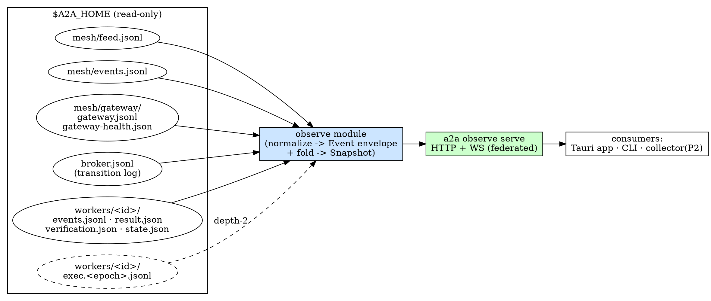

# a2a Observability Plane — Design

**Status:** approved-shape, spec for review (2026-09-17)
**Sub-project:** 1 of 2. The **Tauri management app** (sub-project 2) is specced
separately and consumes this plane's contract; do not fold it in here.

## Goal

Give any system a read-only, structured view of everything an a2a agent is
doing — the inter-agent mesh traffic **and** each agent's own Codex workers —
so operators (and, later, a central collector and a management UI) can watch,
replay, and correlate agent activity without touching agent state.

## Context

An a2a "agent" is one `$A2A_HOME`: a Claude orchestrator plus its Codex
workers, optionally enrolled in a mesh fleet. Everything it does is already
recorded on disk as append-only artifacts (see **Sources**). Today the only way
to see it is ad-hoc CLI (`a2a status`, `a2a tail`, `a2a mesh feed`) against one
home at a time. This plane normalizes those artifacts into one event stream +
snapshot API behind a small local server, so external systems get a uniform,
subscribable view.

There is an existing **`a2a mesh gateway`** (the WS/TLS transport + registry
replication daemon). This plane is a *different* thing and is deliberately kept
separate from it (approach A, below). Throughout this doc "gateway" is avoided;
the subsystem is the **observability plane** (`observe`).

## Global Constraints

- **Read-only.** The plane MUST NOT write to `$A2A_HOME`. It opens artifacts
  read-only and never mutates worker/mesh/broker state. Its own bookkeeping (if
  any) lives outside the agent home.
- **Additive.** It reads artifacts that already exist; it does not require
  changing how the broker or mesh writes them. New capture (depth-2) is opt-in
  and additive.
- **Rust, single `a2a` binary.** The plane is a module in the a2a crate plus an
  `a2a observe` subcommand; no new top-level binary in Phase 1.
- **Repo:** `~/dev/a2a`. Commits `--no-verify`, never `cargo fmt`, clippy at the
  established baseline. Same release discipline as the rest of a2a.
- **Forward-compatible contract.** Consumers MUST ignore unknown `plane`/`kind`
  values and unknown envelope fields, so depth-2 and new event kinds ship
  without breaking existing consumers.

## Scope

**Phase 1 (this spec builds):** federated, read-only, management-depth.
- Federated: each home serves its own local endpoint (`a2a observe serve`).
- Read-only: observation only; no control actions.
- Management-depth: mesh traffic + worker **lifecycle & steering** events +
  derived snapshot state. NOT per-turn/tool-call forensic detail.

**Provisioned, not built (later phases / spikes):**
- **Central collector** (Phase 2): a service that connects to each federated
  endpoint and fans events into one store for cross-agent history/correlation.
- **Depth-2 forensic capture**: per-turn / per-tool-call events sourced from
  `workers/<id>/exec.<epoch>.jsonl`.
- **Control-brokering spike**: mutating endpoints (steer/answer/kill through the
  plane). Phase 1 stays read-only; control lives in each agent's broker.

**Out of scope:** the Tauri app; multi-tenant authz; the control plane.

## Architecture



Two layers:

1. **`observe` module** (`src/observe/`) — pure, reusable, no I/O policy of its
   own beyond reading the home. Responsibilities:
   - **Normalizers**: map each source artifact's records into the unified
     **Event** envelope.
   - **Fold**: derive the current **Snapshot** (agents, workers, work items,
     peers, health) from the same sources.
   - **Tailer**: watch sources for new records and emit new Events live.
   - **Cursor**: encode/resume a position so a consumer can replay a delta.
   The collector (Phase 2) links this same module — the federated endpoints are
   just its upstream data sources, so the schema is identical end-to-end.

2. **`a2a observe serve`** — a thin async HTTP+WS server over one `$A2A_HOME`
   that exposes the module: live stream, snapshot, targeted queries. Read-only.

## The Event envelope (the contract)

The load-bearing artifact. Both the app and the future collector consume this;
it is versioned and additively extensible.

```jsonc
{
  "v": 1,
  "ts": "2026-09-17T18:22:01.412Z",     // event time (source ts if present, else observed)
  "agent_id": "gw-host-c726ba",          // this home's gateway_id / identity
  "plane": "mesh" | "work" | "worker" | "presence" | "health",
  "kind": "feed_entry",                  // see taxonomy below
  "subject": { "worker_id": null, "work_id": null, "peer": null },
  "payload": { /* kind-specific, mirrors the source record */ },
  "src": { "artifact": "mesh/feed.jsonl", "ref": "origin_seq=42" }  // provenance
}
```

**Plane taxonomy (Phase 1):**

| plane | kinds (initial) | source |
|-------|-----------------|--------|
| `mesh` | `feed_entry`, `note`, `deferral`, `link_limit` | `feed.jsonl`, `events.jsonl`, `gateway.jsonl` |
| `work` | `work_offered`, `work_approved`, `work_released`, `work_done`, `work_failed`, `work_result_empty` | work store transitions in `events.jsonl` / `broker.jsonl` |
| `worker` | `worker_spawned`, `worker_status`, `worker_awaiting_input`, `worker_answered`, `worker_result`, `worker_interrupted`, `worker_killed`, `worker_budget_exhausted`, `worker_respawned` | `workers/<id>/events.jsonl`, `result.json`, `broker.jsonl` |
| `presence` | `peer_up`, `peer_down`, `peer_version` | presence + `gateway-health.json` |
| `health` | `limits`, `replication`, `exposure`, `rotation` | `gateway-health.json` |

**Reserved for later (consumers already tolerate them):**
- plane `turn` — kinds `turn_started`, `turn_completed` (depth-2, from
  `exec.<epoch>.jsonl`).
- plane `tool_call` — kinds `tool_call`, `tool_result` (depth-2).
- A future control-audit plane, if the control spike lands.

**Compatibility rule:** unknown `plane`, unknown `kind`, and unknown envelope
fields MUST be ignored by consumers. New kinds are additive; existing kinds'
payloads only grow (never repurpose a field).

## Cursor & replay

A consumer resumes with an **opaque cursor token** (`?from=<cursor>`), not a
dense integer. The token encodes per-source watermarks (e.g. feed
`origin_seq` high-water, `events.jsonl` seq, `gateway.jsonl`/`broker.jsonl`
line position + rotation generation, per-worker `events.jsonl` positions). The
plane resumes each source from its encoded watermark and merges by `ts`.

Why opaque, not a global integer seq:
- **Read-only:** a dense global seq would need a durable plane-owned index; the
  home is read-only, so we don't persist one there.
- **Compaction-safe:** `feed.jsonl` is compacted and logs rotate; watermarks
  anchored to source-native identifiers survive that, a dense index would shift.

`/snapshot` returns the cursor current as of the fold, so the pattern is:
`GET /snapshot` → render → `WS /stream?from=<snapshot.cursor>` for the live
delta. Cursors are forward-only; a cursor older than the retained/compacted
window replays from the earliest still-available record and flags a gap.

*(Optimization deferred: an out-of-home durable index for O(1) resume if event
volume ever makes the merge-scan too slow. Not needed at management-depth.)*

## Serve surface (Phase 1)

Local HTTP + WS over one home. All endpoints are read-only.

- `GET /snapshot` — folded current state: `{ agent, workers[], work[], peers[],
  health, cursor }`.
- `WS /stream?from=<cursor>&planes=mesh,work,worker,...` — replay from cursor
  then live tail. `planes` filter optional. Server heartbeats to keep the
  socket alive; client resumes with its last cursor on reconnect.
- `GET /agents` — this home's identity + summary counts (federated Phase 1
  returns the single local agent; shape already supports many so the collector
  reuses it).
- `GET /workers` · `GET /workers/{id}` — worker list / detail (status, lane,
  worktree, turn budget, last result, awaiting-input question if any).
- `GET /work` · `GET /work/{id}` — mesh work items and their state.
- `GET /feed?from=<cursor>&limit=` — recent feed slice.
- `GET /healthz` — plane liveness (not agent health).

Content-type `application/json`; WS frames are one Event envelope each.

## Transport & auth (Phase 1)

- Binds `127.0.0.1:<port>` by default (`--bind`, `--port`). Loopback needs no
  auth.
- For a consumer on another machine (the app, or the Phase-2 collector), a
  **per-home read token** gates access (`--token <value>` or a token file path
  outside the home). Bearer on HTTP, query/subprotocol on WS. Read-scoped by
  construction — there is nothing to authorize beyond "may read this home."
- TLS optional in Phase 1 (`--tls` reusing `TlsIdentity::self_signed`, as the
  mesh does); loopback default runs plaintext. Remote deployments terminate TLS
  here or via the operator's own tunnel.
- **Provision:** the read token is the same credential the Phase-2 collector
  will present to each federated endpoint; keep it per-home and read-only.

## Read-only guarantee

- Every source is opened read-only; the plane holds no write handle to
  `$A2A_HOME`.
- Tailing uses read + poll (reuse the existing 1s feed-follow poll style) or an
  OS watch; either way, read-only.
- **Test:** snapshot the home's file tree (paths + sizes + mtimes) before and
  after a serve session that streams + serves snapshots + handles a worker
  lifecycle in a companion home; assert byte-for-byte unchanged.

## Error handling & edge cases

- **Home missing / not initialized** → `observe serve` exits with a clear
  precondition error naming the expected path.
- **Log rotation mid-tail** (`events.jsonl`→`.1`, feed compaction) → the tailer
  detects generation change and continues without dropping or double-emitting;
  the cursor encodes generation so replay stays correct.
- **Partial / trailing-garbage jsonl line** (writer mid-append) → skip
  unparseable trailing lines, retry on next poll; never crash the stream.
- **Worker dir races** (dir appears before `result.json`) → emit lifecycle
  events as artifacts appear; missing optional files are absent, not errors.
- **WS backpressure** → per-connection bounded queue; a slow consumer that
  overflows is disconnected with a resumable cursor (it reconnects `?from=`),
  never blocking other consumers or the tailer.
- **Cursor older than retained window** → replay from earliest available +
  `gap: true` on the first frame so the consumer knows history was compacted.
- **Corrupt `gateway-health.json`** → snapshot returns `health: null` with a
  soft warning rather than failing the whole snapshot.

## Testing strategy

- **Unit:** each normalizer (source record → Event) with fixture records; the
  fold (sources → Snapshot) for representative states; cursor encode/resume;
  the forward-compat rule (unknown plane/kind survives round-trip).
- **Integration:** stand up `observe serve` over a seeded home; assert
  `/snapshot` shape, then `WS /stream?from=<cursor>` delivers the expected
  delta; drive a worker lifecycle in a companion home and assert the events
  surface live; force a log rotation and assert continuity.
- **Read-only assertion** (above) as its own test.
- **No control paths exist** — assert the serve surface has no mutating route.
- Gated where it needs a real Codex worker; hermetic otherwise, matching a2a's
  existing test conventions.

## CLI surface

- `a2a observe serve [--home <path>] [--bind 127.0.0.1] [--port N] [--token
  <v>|--token-file <path>] [--tls] [--planes <list>]` — run the federated
  endpoint.
- `a2a observe tail [--home] [--from <cursor>] [--planes]` — a CLI consumer of
  the same stream (dogfood + a zero-UI way to watch), prints Event envelopes.
- `a2a observe snapshot [--home] [--json]` — one-shot snapshot to stdout.

## Phasing & seams (what this design reserves)

1. **Phase 1 (build now):** `observe` module + `a2a observe serve` (federated,
   read-only, management-depth) + `observe tail`/`snapshot`.
2. **Phase 2 — central collector:** a `collect` binary (same repo) that dials
   each federated `/stream` with its read token, fans Events into a store
   (Neon, mirroring the registry pattern), and re-exposes the *same* Event +
   Snapshot contract with cross-agent queries. Seam: identical schema; the
   federated endpoint is just an upstream. Cursor already supports per-source
   resume across restarts.
3. **Depth-2 forensic capture:** add `turn`/`tool_call` normalizers over
   `workers/<id>/exec.<epoch>.jsonl`; already-reserved planes mean no consumer
   break. Opt-in (`--planes turn,tool_call` or a capture flag) because of volume.
4. **Control spike → Agent Command Channel (committed 2026-09-21):** a separate,
   auth-gated mutating surface. The management-app spec resolved this from a
   "spike to evaluate" into a committed a2a-core capability — the **Agent Command
   Channel** — that delivers imperative directives to the orchestrator (compact /
   change model+effort / kick off a brainstorm) and steer/answer/kill to the
   broker, and unlocks remote control. **This plane does not change:** it stays
   read-only by hard invariant; the Command Channel is a *distinct* surface built
   on its own brainstorm + spec, not a route added to `observe serve`. Build
   order: this read-only plane first (the app depends on its contract), then the
   Command Channel.

## Self-review notes

- Read-only is a hard invariant with a dedicated test — the whole value prop is
  "safe tap."
- The Event envelope is the single contract; everything else (federation vs
  collector, management vs forensic depth) is a source/deployment concern behind
  it, which is what lets us build federated now and add the collector without
  reworking consumers.
- YAGNI held: no durable index, no control, no forensic capture in Phase 1 —
  each is a named seam, not built.
