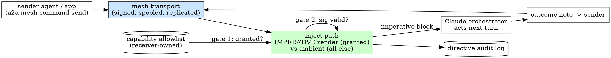

# a2a Agent Command Channel — Design

**Status:** approved-shape, spec for review (2026-09-25)
**Bead:** a2a-byd. Prerequisite for the management app's (Epic 2) agent-level
controls — the app spec's Resolved-decision #1 committed to building this. Phase
2 (idle-wake + harness actions) is a2a-ota; it is a named seam here, not built.

## Goal

An authenticated, **imperative** directive channel that delivers a "do X now"
instruction to a remote agent's Claude **orchestrator** over the mesh, which the
orchestrator acts on at its next turn, and whose outcome reports back to the
sender. This is the capability a2a lacks today: it can command **workers** (the
broker) and gossip to agents **ambiently** (mesh notes / inject), but it has no
way to make the orchestrator itself *act on a directive*.

## Context — why this is hard, and what it deliberately changes

a2a's mesh-inject path (`src/mesh/notes.rs`) is deliberately **ambient**: peer
notes and feed entries are rendered into the orchestrator's context wrapped as
**"data, not instructions"**. That is a safety invariant — a peer's note must
never command your Claude session. It is also the exact limitation the Agent
Command Channel must overcome: an operator (via the management app) wants to tell
an agent "start a brainstorm on T" and have it *happen*.

So the ACC **intentionally carves a narrow, consented exception** into the
instruction-source boundary: a directive that is **(a) capability-granted by the
receiving agent's operator and (b) signature-verified** is rendered as an
**executable instruction** the orchestrator obeys. Everything ungranted stays
ambient data. The whole design is organized around making that exception narrow,
explicit, and auditable — the grant is the operator's consent, and it is the
trust boundary.

**The directive-class split (from brainstorming), which bounds v1:** the model
cannot self-trigger **harness actions** — `/compact`, `/model` are *user* input,
not model output (this is why the precompact-herdr injector types them into the
pane *as the user*). So harness actions cannot be delivered by a mesh prompt;
they need pane injection. **v1 builds only the mesh channel for *session
actions*** (things the model can do inside a turn: run a brainstorm, follow an
instruction). Harness actions + waking an idle orchestrator are Phase 2 (a2a-ota,
pane injection).

## Global Constraints

- **The imperative exception is gated twice, always.** A directive is rendered
  imperatively **only** when the sender is (1) on the receiving agent's
  capability allowlist AND (2) its signature verifies against the fleet RootSet.
  Fail either → the directive is NOT imperative (dropped, or logged as
  refused — never silently downgraded to an ambient note that could still
  nudge). This is a hard invariant with a dedicated test.
- **Ambient default is unchanged.** Ordinary notes/feed keep the "data, not
  instructions" rendering. The ACC adds a *separate* rendering used only for
  granted directives; it never changes how notes render.
- **Reuse the mesh, don't fork it.** Directives ride the existing fleet-scoped,
  signed, spooled, idempotent, replicated note transport (L2/L4). A directive is
  a new *message class*, not a new transport.
- **Auditable.** Every directive received — acted, refused, or dropped — is
  logged locally (who, when, directive_id, verdict) so an operator can review
  what commanded their orchestrator.
- **Rust, single `a2a` binary.** New module(s) under `src/mesh/`, new
  `a2a mesh command …` CLI. Commits `--no-verify`, never `cargo fmt`, clippy at
  the established baseline.
- **No idle-wake in v1.** Delivery is next-turn (see Delivery). Prompt delivery
  to an idle session is a2a-ota.

## Scope

**v1 builds:**
- A signed **directive** message class over the mesh (remote-capable).
- A per-agent **capability grant** allowlist (`grant`/`revoke`/`list`).
- **Next-turn imperative delivery**: the inject path renders a granted+verified
  directive as an imperative instruction block at the orchestrator's next turn.
- **Outcome reporting** back to the sender (a directive-outcome note).
- A local **directive audit log**.

**Provisioned, not built (seams):**
- **Idle-wake + harness actions** (compact, model/effort) via pane injection —
  a2a-ota (Phase 2). The directive schema reserves a `class` field so
  harness-class directives are representable but refused in v1 with a clear code.
- **Typed directive vocabulary** — v1 carries a freeform imperative
  `instruction`; a structured/enumerated vocabulary (with per-type authz) is a
  later refinement. The schema reserves room.

**Out of scope:** commanding workers (that is the broker); the app itself.

## Architecture



- **Send:** `a2a mesh command send --to <agent> --instruction <text>` mints a
  signed directive (directive_id = ULID, from, target, ts, class=`session`,
  instruction, sig) and routes it over the mesh like a note.
- **Receive:** the directive lands in the target's mesh store. At the target's
  next orchestrator turn, the inject path evaluates it against **both gates**
  (allowlist + signature). Granted+verified → rendered in an **imperative block**
  ("ACT ON THIS DIRECTIVE FROM <granted peer>: <instruction>"). Ungranted or
  unverified → refused (logged), never imperative.
- **Act:** the orchestrator (Claude) obeys the imperative block that turn.
- **Report:** the orchestrator posts a directive-outcome note back to `from`
  (directive_id + acted/failed/refused + one-line summary).
- **Audit:** every directive + verdict is appended to a local log.

## The directive message (the contract)

A new mesh message class alongside notes. Signed with the sender's gateway key
(same machinery as L4 signed rows / notes), so the receiver verifies
sender identity against the fleet RootSet.

```jsonc
{
  "kind": "directive",
  "directive_id": "01J...",        // ULID, idempotency key
  "from": "gw-host-abc",           // sender gateway_id (signed identity)
  "target": "gw-host-xyz",         // intended orchestrator
  "ts": "2026-09-25T...Z",
  "class": "session",              // v1: only "session" acts; "harness" reserved -> refused (a2a-ota)
  "instruction": "start a brainstorm on <topic>",  // freeform imperative (v1)
  "sig": "..."                     // over the canonical directive bytes
}
```

Idempotent by `directive_id` (a redelivered directive acts at most once —
dedup like note_id). Forward-compatible: unknown `class` → refused, not crash.

## Capability grant model (the auth core)

- Ambient by default: **no** peer can issue an imperative directive until the
  receiving agent's operator grants it.
- Per-agent allowlist of granted sender gateway_ids, stored under `$A2A_HOME`
  (e.g. `mesh/command-grants.json`, 0600), owner-writable only.
- `a2a mesh command grant <peer_gateway_id>` — add. `revoke <peer>` — remove.
  `list` — show. A grant is the operator's explicit, revocable consent that this
  peer may command their orchestrator.
- The grant is checked **at delivery time** (receiver-side), so revocation takes
  effect immediately for not-yet-delivered directives.
- **Self-grant:** an agent's own owner/self is implicitly granted (the app
  controlling *your own* agents is the primary use case; a self-directive needs
  no peer grant). Cross-agent peer command requires an explicit grant.

## Delivery + imperative rendering (security-critical)

- The inject path gains a **directive evaluator** run before it builds the
  inject block. For each pending directive: verify signature → check the
  allowlist → on pass, emit an **imperative block**; on fail, drop + audit
  (`refused: ungranted` / `refused: bad-signature` / `refused: harness-class`).
- The imperative block is **visually and semantically distinct** from the
  ambient notes block: it names the granted sender, states the directive is an
  authenticated instruction the operator consented to receive, and carries the
  instruction. It is the ONLY content the plane ever renders as an instruction.
- Ambient notes/feed continue to render exactly as today (data, not
  instructions) in the same digest.
- **Next-turn timing:** the evaluator runs on the existing inject cadence (turn
  boundary). No idle-wake (a2a-ota).

## Outcome reporting

- After acting (or refusing/failing), the orchestrator posts a
  **directive-outcome** note addressed to `from`: `{directive_id, verdict:
  acted|failed|refused, reason?, summary?}`. Reuses the note transport, so it
  replicates back across the mesh.
- The sender (app) correlates by `directive_id`. This is how the app's
  "kick off brainstorming" button learns it worked.

## Security & the instruction-boundary exception

This section is the point of the spec.

- **Threat:** a hostile or compromised fleet member sends "do X" and drives your
  orchestrator (exfiltrate, run destructive work, etc.).
- **Mitigations, layered:**
  1. **Grant gate** — no peer commands you until you `grant` them. Default-deny.
  2. **Signature gate** — a directive must be signed by the granted peer's
     gateway key, verified against the fleet RootSet (a stolen `directive` frame
     from a non-key-holder is useless). Reuses L4 signing.
  3. **Class gate** — v1 only acts on `session` directives; `harness` is refused
     (no compact/model over the mesh in v1).
  4. **Audit** — every directive + verdict logged for after-the-fact review.
  5. **The orchestrator still owns the action** — the imperative block instructs
     Claude, which applies its normal safety judgment to the *content* of the
     instruction (a directive to do something destructive/prohibited is still
     subject to the orchestrator's own guardrails; the ACC grants "this peer may
     ask", not "this peer may bypass safety").
- **Residual (stated):** a granted peer is trusted to issue reasonable
  directives; grant is coarse-grained in v1 (no per-directive-type authz). A
  compromised granted peer within its grant is a residual risk — revocation is
  the control. Per-type authz + rate limits are follow-ups.
- **Explicitly NOT weakened:** ambient notes/feed remain data-not-instructions;
  the exception is only the granted+signed directive class.

## CLI surface

- `a2a mesh command grant <peer_gateway_id>` / `revoke <peer>` / `list` — manage
  the allowlist.
- `a2a mesh command send --to <agent> --instruction <text> [--instruction-file
  <f>]` — mint + route a signed directive (instruction via file to keep it off
  argv, matching the note/answer discipline).
- `a2a mesh command log` — show the local directive audit log.

## Testing strategy

- **Unit:** directive canonical-bytes + signature round-trip; the two-gate
  evaluator (granted+valid → imperative; ungranted → refused; bad-sig → refused;
  harness-class → refused); idempotent dedup by directive_id; grant
  store add/revoke/list.
- **Rendering invariant:** the imperative block appears ONLY for granted+verified
  directives; ambient notes in the same digest still render as
  data-not-instructions. A directive from an ungranted peer produces NO
  imperative content anywhere in the inject digest.
- **Integration (mesh):** a directive sent from A to B (B has granted A) is
  routed, evaluated, rendered imperative in B's next inject digest, and an
  outcome note routes back to A. An un-granted A produces a refused-audit and no
  imperative render. Gated where a live fleet is needed; hermetic otherwise.
- **Audit:** every path writes the expected audit entry.

## Phasing & seams

1. **v1 (this spec):** signed directive class + capability grants + next-turn
   imperative render + outcome notes + audit (session-class only).
2. **a2a-ota:** idle-wake + harness actions (compact, model/effort) via a
   pane-injection bridge (generalize the precompact-herdr injector). The `class`
   field + refusal path are the seam.
3. **Later:** typed directive vocabulary with per-type authz + rate limiting.

## Self-review notes

- The instruction-boundary exception is the whole risk surface; it is gated
  twice (grant + signature), class-limited, audited, and leaves ambient
  rendering untouched — every one of those has a test.
- Reuses the mesh transport + L4 signing rather than inventing a channel, so the
  new surface is the message class + the evaluator + the grant store, not a new
  network path.
- YAGNI held: freeform instruction (not a typed vocabulary), next-turn (no wake),
  session-only (no harness) — each deferred with a named seam.
